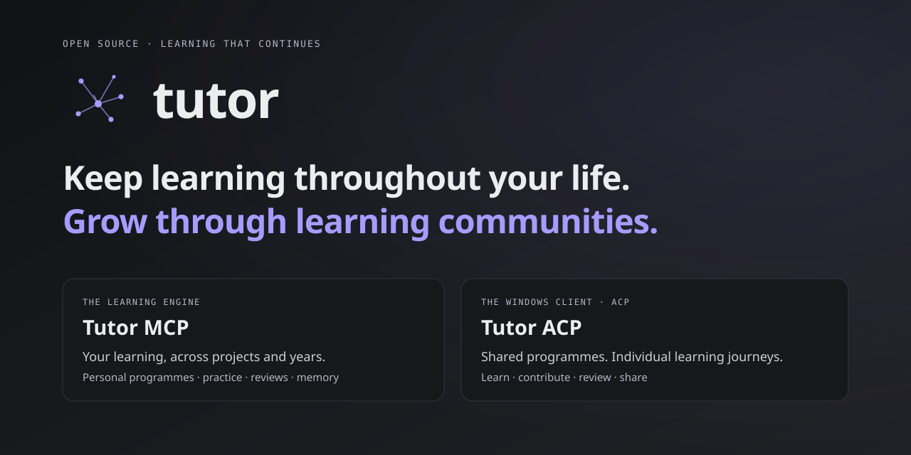

<p align="center">
  
</p>

<p align="center">
  <a href="LICENSE"></a>
  <a href="https://github.com/ArnaudGuiovanna/tutor-mcp/releases/tag/v0.7.0"></a>
  <a href="client/README.md"></a>
</p>

# Tutor

**Lifelong learning with Tutor MCP. Learning communities with Tutor ACP.**

Start with something you want to learn. Turn that conversation into a personal learning programme, practise at your own pace, and pick it up again as your projects and interests evolve. Within a learning community, build and share programmes while each person follows their own learning journey.

Tutor is open source and has two complementary parts:

| Component | What it brings |
|---|---|
| **Tutor MCP** — the learning engine | Persistent programmes, adaptive activities, spaced reviews, assessments and memory that support learning throughout your life. Connect it to a compatible AI assistant. |
| **Tutor ACP** — the desktop client | A Windows application for learning with Codex or Claude and managing personal and institutional programmes. It gives learning communities a place to create, review and share their programmes. |

**[Download Tutor ACP for Windows](https://github.com/ArnaudGuiovanna/tutor-mcp/releases/download/v0.7.0/Tutor_ACP_0.0.1_windows_x64-setup.exe)** · **[Get Tutor MCP v0.7.0](https://github.com/ArnaudGuiovanna/tutor-mcp/releases/tag/v0.7.0)**

[Lifelong learning](#lifelong-learning) · [Learning communities](#learning-communities) · [Windows client](#windows-client) · [Demo](#demo) · [Install the engine](#install-the-engine) · [How it works](#how-it-works) · [Documentation](#documentation)

## Lifelong learning

Learning rarely follows a single course from beginning to end. A new job calls for a new skill; a personal project raises new questions; a subject you left behind becomes useful again. Tutor keeps the learning context so you can return, practise and move forward.

- **Begin in the conversation.** “I want to learn Go” can create a private programme and start a first activity. There is no separate intention form or draft approval to complete first.
- **Learn more than one subject.** Keep personal programmes in one library, choose the active programme explicitly, and return to it in another conversation without mixing learning histories.
- **Practise what needs attention.** Concepts, prerequisites, observations and review dates help the engine choose the next lesson, exercise, review or assessment.
- **Resume with context.** Persistent learning state and session memory help the tutor pick up where you left off, even when you use another compatible AI client connected to the same Tutor installation.
- **Understand your progress.** Distinguish a knowledge estimate, a scheduled review and demonstrated performance on an assessment. A convincing conversation alone is not evidence of mastery.

Use it to explore a new interest, prepare for a career change or develop a skill alongside your everyday work. Your programme can evolve with those goals.

## Learning communities

A team, association or teaching community can maintain a shared learning catalogue. Members learn at their own pace; authors and authorised trainers can improve the common programmes.

- **Create and share programmes.** Sharing a personal programme creates a copy of its design. It does not publish your conversations or private progress.
- **Choose the audience.** Offer a programme to all members of your institution or invite named recipients. Named offers remain hidden from non-invitees; “all members” refers to that institution.
- **Review contributions.** An owner can request changes or approve and publish a submitted revision. An owner may allow publication without prior review for a specific programme.
- **Improve programmes together.** Manual editing and AI proposals use the same editor and server validation. Review concepts, objectives, prerequisites and the effects of a change before applying it.
- **Keep published learning paths stable.** Published versions are immutable. Existing learners keep their enrolled version until an explicit migration is chosen.

The institution controls membership, contribution rights and publication policy, including whether personal programmes are allowed. Shared programmes and individual learning state remain distinct.

An onboarding team can maintain its own curriculum; a trainer can refine a programme with feedback; an association can offer learning paths to its members. The shared resource is the programme, with access and responsibilities made explicit.

## Windows client

**Tutor ACP 0.0.1** is available as a [Windows x64 installer](https://github.com/ArnaudGuiovanna/tutor-mcp/releases/download/v0.7.0/Tutor_ACP_0.0.1_windows_x64-setup.exe), alongside Tutor MCP **v0.7.0**. Codex and Claude adapters and their Node.js runtime are included; a separate Node/npm installation is not needed for those bundled agents.

- **Conversation and Formations** are the two main destinations. The last conversation resumes when you reopen the account; your library brings together personal and institutional programmes.
- A programme has **Programme**, **Progression**, and **Partage et accès** tabs for its design, learning state and audience.
- **Account** has its own page. **Settings** groups Agents, Institution, Members, and Reading and appearance.
- Choose French or English, a light/dark/system theme, text size, line height and reduced motion. Preferences are saved per account.
- Remember MCP permissions per tool across conversations and restarts, for the selected account, server and agent. Review or revoke them in Settings; server access rights still apply.
- Follow text activity as the agent calls tools and prepares its answer. Model and reasoning controls use the options the selected agent actually supports.
- Archive, restore or delete programmes when permitted; distinguish removing a local account from requesting erasure of institutional data.

### Start with Windows

1. Install [Tutor ACP 0.0.1](https://github.com/ArnaudGuiovanna/tutor-mcp/releases/download/v0.7.0/Tutor_ACP_0.0.1_windows_x64-setup.exe).
2. Choose Codex or Claude and connect your provider account. Provider access and any associated costs are separate from Tutor.
3. Connect Tutor: use a [local Tutor MCP binary](docs/installation.md#local-client-configuration), or your institution's address and an authorised Tutor identity. The [client guide](client/README.md#connexion-à-tutor) explains setup and identity backups.
4. Write **“I want to learn Go”** or **« Je veux apprendre le Go »**, then begin your personal programme.

If setup is incomplete, your message stays **À envoyer** (“To send”) in the account. Complete the connection in the same window and it resumes once.

See the [desktop client guide](client/README.md) for native Windows and WSL2 configuration, account management and development. The [qualification guide](client/docs/runtime-qualification.md) and [release reports](https://github.com/ArnaudGuiovanna/tutor-mcp/releases/tag/v0.7.0) describe the tested Windows installer and the scope of each check.

## Demo

### Learning engine in Claude Code

<p align="center">
  
</p>

This recording shows the **MCP learning engine in a terminal client**. It is not a recording of the Windows ACP application.

Tutor maps Go backend development into an 18-concept skill graph, diagnoses what transfers from the learner's Python background, and checks prerequisites before assessment. After practice, the transfer probe runs on an unseen debugging scenario and records the outcome against a frozen rubric. Session notes preserve the context for the next conversation.

The [conversation and formations guide](docs/tutor-conversation-formations.md) also includes interface previews with demonstration data, clearly separated from the results of real learning sessions.

## Install the engine

Tutor MCP works with the desktop client and with other compatible MCP clients. Choose where your learning data lives; every profile uses the same learning engine.

| Profile | Best for | Setup |
|---|---|---|
| **Local** | Learning on your own computer | One binary + `--local`. Your MCP client starts it; SQLite stores your history. No server account setup. [Local setup](docs/installation.md#local-client-configuration) |
| **Hobby** | A personal VPS or a small group using MCP clients | `--profile hobby`, SQLite and an HTTPS proxy. Invite users over SSH; they sign in with a username and password. [Native installation](docs/installation.md#native-hobby-vps-binary-systemd-and-caddy) · [Docker Compose](docs/installation.md#hobby-vps-with-docker-compose) |
| **Institution** | An organisation running a shared service | Public-key identities, member access, PostgreSQL and separate API/worker/migrator roles. [Institutional setup](docs/installation.md#institutional-deployment) |

[Download Tutor MCP v0.7.0](https://github.com/ArnaudGuiovanna/tutor-mcp/releases/tag/v0.7.0) for **Linux, macOS or Windows**, on **amd64 or arm64**. Each archive includes its notices; the release provides SHA-256 checksums. See [installation and upgrades](docs/installation.md) for installers, service configuration, backups and migrations.

### Build and connect an MCP client

With Git and [Go 1.26.10 or a newer patched release](https://go.dev/dl/):

```sh
git clone --branch main https://github.com/ArnaudGuiovanna/tutor-mcp.git
cd tutor-mcp
go build .
```

This creates `tutor-mcp` (`tutor-mcp.exe` on Windows). For a client using `mcpServers` JSON, such as Claude Desktop, add this to its MCP configuration and replace `command` with the binary's full path:

```json
{
  "mcpServers": {
    "tutor": {
      "command": "/absolute/path/to/tutor-mcp",
      "args": ["--local"]
    }
  }
}
```

On Windows, use a path such as `C:/tools/tutor-mcp.exe`. Restart your client. It launches Tutor automatically and stores your learning profile in `~/.tutor-mcp/local`.

Then ask:

> Use Tutor MCP to help me learn Go for backend development. Check whether I already have a programme, create one if needed, and guide me through a first 20-minute session. Save my progress when we finish.

Next time: **“Resume my Go learning with Tutor MCP.”** Connect to the same Tutor installation to continue with the same history.

Use [Claude Code](docs/installation.md#claude-code), Claude Desktop, ChatGPT, Hermes, Pi with an MCP extension, Gemini CLI, Le Chat or another compatible MCP client. ChatGPT and other cloud clients need a remotely reachable HTTPS service. The [client guide](docs/clients.md) covers each connection method.

<p align="left">
  <a href="docs/clients.md"></a>
  &nbsp;&nbsp;
  <a href="docs/clients.md"></a>
  &nbsp;&nbsp;
  <a href="docs/clients.md"></a>
  &nbsp;&nbsp;
  <a href="docs/clients.md"></a>
</p>

## How it works

**Generative teaching. Deterministic pedagogy.** The AI handles conversation, explanations and exercises. Tutor MCP keeps the learning state and applies the rules used to select activities.

| Layer | What it keeps | Why it matters |
|---|---|---|
| **Learning engine** | Concepts, prerequisites, knowledge estimates, review timing and assessment evidence | Chooses what to practise, revisit or assess next. |
| **Narrative memory** | Session summaries, goals, recurring misconceptions and useful learner context | Helps the AI pick up the thread and explain things in context. |

The loop is **choose an activity → teach and practise → record the response → update the learning state**. The agent calls `get_next_activity` for guidance and `record_interaction` to save observations. Plain conversation alone does not update those observations.

Bayesian Knowledge Tracing (BKT) estimates knowledge; FSRS schedules reviews. Individual estimates evolve during learning. For shared programmes, collective calibration is isolated by institution, version and concept, and requires **30 contributing learners with at least five admissible observations each**. Sharing a private programme does not incorporate its private learning history into that calibration.

Programmes, active conversation context, revisions, progress and permissions are controlled by the server. The desktop client displays that state rather than calculating its own learning progress. Decisions are inspectable, and their quality depends on the evidence recorded. See the [architecture](docs/architecture.md), [algorithm guide](docs/algorithms.md) and [learning integrity](docs/learning-integrity.md).

## Documentation

### Learning and development

| Topic | Read more |
|---|---|
| Desktop application and bundled agents | [Tutor ACP](client/README.md) |
| Conversation, library, editing and sharing | [Conversation and formations](docs/tutor-conversation-formations.md) |
| Windows qualification and its limits | [Runtime qualification](client/docs/runtime-qualification.md) |
| Architecture and runtime components | [Architecture](docs/architecture.md) |
| Knowledge tracing, reviews and activity selection | [Algorithms](docs/algorithms.md) |
| MCP tool catalogue and calling conventions | [MCP tools](docs/mcp-tools.md) |
| Learning evidence and assessment | [Learning integrity](docs/learning-integrity.md) · [Assessment certification](docs/assessment-certification.md) |
| Contributing and project changes | [Contributing](CONTRIBUTING.md) · [Changelog](CHANGELOG.md) |

### Installation and operations

| I want to… | Documentation |
|---|---|
| Connect another MCP client | [Client guide](docs/clients.md) |
| Install on Linux, macOS or Windows | [Installation](docs/installation.md) |
| Choose a profile or manage hobby accounts | [Profiles and accounts](docs/profiles.md) |
| Configure ports, storage, OAuth, memory or feature flags | [Configuration](docs/configuration.md) |
| Deploy a VPS with systemd/Caddy or Docker Compose | [Native VPS](docs/installation.md#native-hobby-vps-binary-systemd-and-caddy) · [Compose](docs/installation.md#hobby-vps-with-docker-compose) |
| Operate an institutional service | [Institution setup](docs/installation.md#institutional-deployment) · [Operations](OPERATIONS.md) · [Scaling](docs/saas-runtime-operations.md) |
| Back up, restore or move learning data | [Local/VPS backups](docs/installation.md#backups-restore-and-upgrades) · [Tenant restoration](docs/tenant-restore-runbook.md) |
| Configure authentication, memory or notifications | [OAuth registration](docs/oauth-dcr-production.md) · [OAuth scopes](docs/oauth-granular-scopes-rollout.md) · [Memory](docs/narrative-memory-operations.md) · [Webhooks](docs/webhook-delivery-operations.md) |
| Monitor or secure the service | [SLOs and monitoring](docs/saas-slo.md) · [Security](SECURITY.md) |

## Creator

Created and maintained by **Arnaud Guiovanna** — [aguiovanna.fr](https://www.aguiovanna.fr) · [GitHub](https://github.com/ArnaudGuiovanna).

## License

[MIT](LICENSE) — free to use, modify and distribute, including commercially, with the copyright and license notice preserved.
