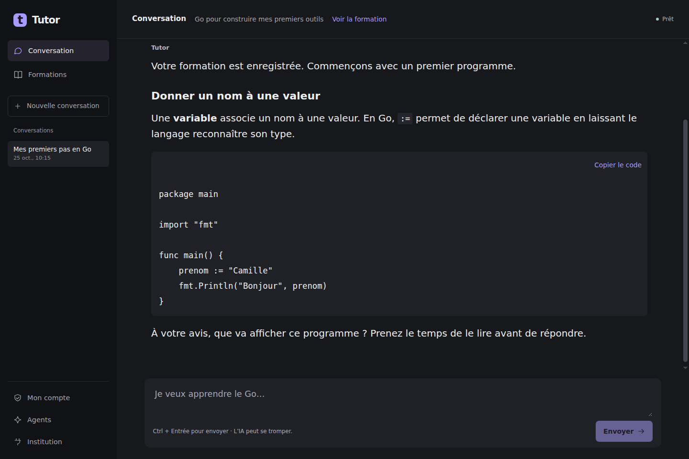
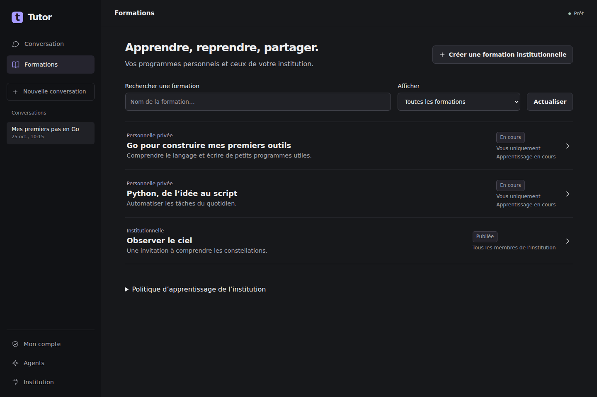
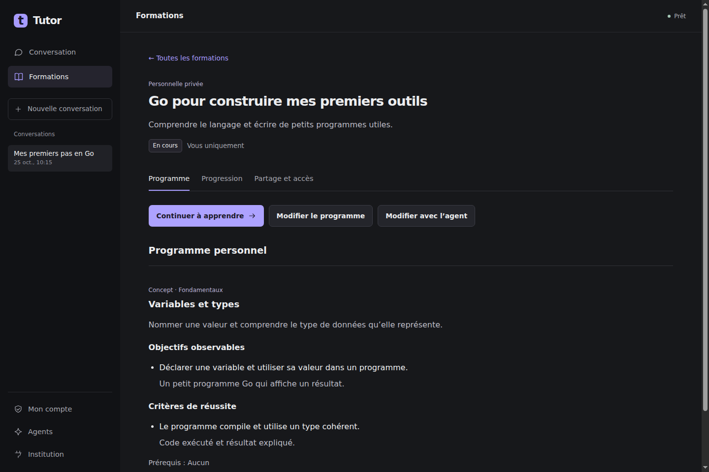
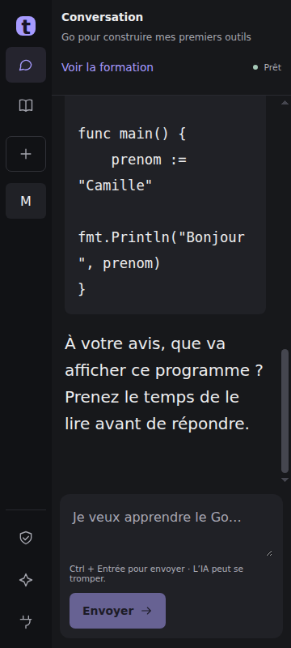
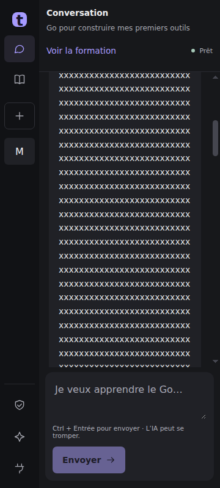

# Tutor 0.2 — conversation et formations

L’accueil est la conversation. « Je veux apprendre le Go » recherche un programme
existant, enregistre sinon une formation personnelle privée, puis démarre une
activité. Tous les rôles suivent ce parcours. Les anciennes intentions restent
des notes historiques ; les clés, coffres, comptes et fichiers de conversation
existants ne sont ni remplacés ni supprimés.

## Contrats et droits

La bibliothèque serveur réunit les domaines privés et les formations communes,
avec recherche, pagination et une ligne par formation. Les références réelles,
la progression personnelle et les capacités accompagnent chaque entrée. Les
offres nominatives sont filtrées dans la bibliothèque, le catalogue historique
et la lecture directe. Une affectation de formateur donne accès au programme et
aux groupes concernés ; elle ne donne pas automatiquement l’édition du programme.

La délégation `formation:contribute` porte une capacité limitée à un programme : auteur, propriétaire
ou éditeur explicitement affecté. Elle n’accorde ni rôle administratif, ni accès
aux données privées d’un autre membre. Les membres sont recherchés par nom ou
clé publique dans la seule institution autorisée.

Une conversation conserve sa sélection côté serveur, sous l’adhésion authentifiée.
Le client transmet son identifiant au transport MCP. L’absence de sélection ne
retombe pas sur le dernier domaine global. `init_domain` peut enregistrer les
définitions, objectifs et critères initiaux ; il confirme sa sélection dans la
même transaction. Les tours locaux conservent le contexte confirmé.

Les trois actions d’édition partagent le même document, les mêmes validations de
prérequis et la même révision attendue. La prévisualisation annonce les concepts
dont les estimations seront réinitialisées. La validation appelle la réconciliation
existante BKT/FSRS et préserve l’historique. Une proposition IA n’applique aucun
changement. L’éditeur conserve le texte en cas de conflit et propose de repartir
explicitement de la version actuelle.

Partager un programme privé copie seulement sa conception. Les observations,
conversations, états BKT et données narratives restent privés. Chaque candidature
conserve son programme soumis, sa révision, son auteur et sa décision motivée.
Une approbation publie dans la même transaction. L’autorisation de publication
libre est limitée à une formation et peut être retirée par son propriétaire.
Une révision ultérieure ne réutilise jamais une ancienne approbation.

La publication conserve l’audience choisie. Les invitations peuvent être reportées
vers l’offre de la nouvelle version, sans créer d’inscription. Les inscrits
gardent leur version ; les migrations existantes restent explicites.
Retirer une invitation ferme également les invitations des anciennes offres.
Une publication ultérieure ne rétablit pas une invitation retirée, y compris
si la décision provient de l’ancienne API de gestion des cohortes.

La politique `allow_free_domains` est exposée dans Formations pour le propriétaire.
Les institutions existantes gardent leur valeur explicite. Le déploiement du pilote
active cette politique sur son seul identifiant, après sauvegarde.

La progression individuelle reste calculée par le moteur. La fiche expose les
dates de révision persistées et les groupes autorisés. Les formations communes
indiquent la référence initiale ou les concepts disposant d’une calibration
collective : 30 apprenants contributeurs et cinq observations admissibles chacun,
isolés par institution, version et concept. Le mécanisme de calibration existant
est conservé ; l’historique privé n’est pas incorporé lors du partage.

## Migration et exploitation

Les migrations `0082_conversation_training` (SQLite) et
`postgres_0074_conversation_training` ajoutent les contextes, propositions,
candidatures, provenances et reçus de reprise. Elles ne publient aucune formation
existante. Après migration PostgreSQL, réappliquer `deploy/postgres-roles.sql`.
Les tables privées participent à l’effacement du membre avec les privilèges worker
minimaux ; les nouvelles données participent aux contrôles de restauration.

Les fichiers `workspace.json` restent au schéma 1 avec des champs optionnels.
Le message À envoyer est conservé dans le compte courant et consommé atomiquement
avec le nouveau tour utilisateur. Un redémarrage ou une reconfiguration ne rejoue
pas un tour déjà enregistré. Les clés et sauvegardes restent dans leurs coffres
existants. La sélection d’un autre compte invalide les anciens événements.

## Vérification et limites des preuves

Les tests serveur couvrent trois formations privées, la pagination/recherche,
Go → Python → Go, l’isolation des comptes et institutions, les révisions obsolètes,
la proposition sans application, la copie privée, les corrections demandées,
l’approbation atomique, la publication libre et le maintien de la version inscrite.
La suite existante de calibration collective vérifie ses seuils et exclusions.
Les mêmes parcours sont exécutés sur SQLite et PostgreSQL ; les tests de rôles
PostgreSQL exercent les grants livrés.

Les tests React couvrent le message avant configuration, sa reprise unique,
l’activation apprenant du propriétaire, l’éditeur commun, le conflit conservé,
la restauration des clés, les événements anciens et la copie exacte du code.
Les tests Rust exercent la persistance, les sessions et le transport réel ACP.
`client/scripts/smoke-learning.rs --live-model` exerce trois créations réelles
avec Codex et une reprise Go après redémarrage dans un profil neuf.
Le [rapport de cet essai réel](assets/tutor-0.2/live-learning-report.json)
confirme les trois formations, la reprise après fermeture et l’absence de doublon.
Il ne revendique pas d’observation évaluée : aucune réponse d’élève n’a été
fabriquée pour ce contrôle de création et de reprise.

Le contrôle Windows installe le vrai paquet et vérifie son arbre UI Automation,
la saisie avant connexion et la navigation clavier. Cette vérification utilise
les [API d’accessibilité WebView2](https://learn.microsoft.com/en-us/microsoft-edge/webview2/concepts/overview-features-apis)
et [UI Automation](https://learn.microsoft.com/en-us/dotnet/api/system.windows.automation.automationelement).
Elle ne remplace pas un audit manuel complet avec Narrator et n’en revendique pas
la réalisation.

Les captures ci-dessous utilisent des données de démonstration injectées uniquement
dans Chromium par le script de qualification. Elles ne prouvent pas un tutorat
réel. Le [rapport de reflow](assets/tutor-0.2/layout-report.json) vérifie sept états
à 1440, 360 et 320 px, y compris code très long et tableau large. Reproduction :
serveur Vite local, Chromium avec CDP local, puis
`node client/scripts/qualify-layout.mjs DOSSIER_DE_SORTIE`.

## Captures de référence

La hiérarchie visuelle et les réglages de lecture suivent les principes de
[Linear](https://linear.app/now/behind-the-latest-design-refresh) et
[Discord](https://discord.com/blog/making-discord-on-desktop-look-just-right-display-settings-to-ease-the-eyes),
avec les couleurs et dimensions validées pour Tutor.

